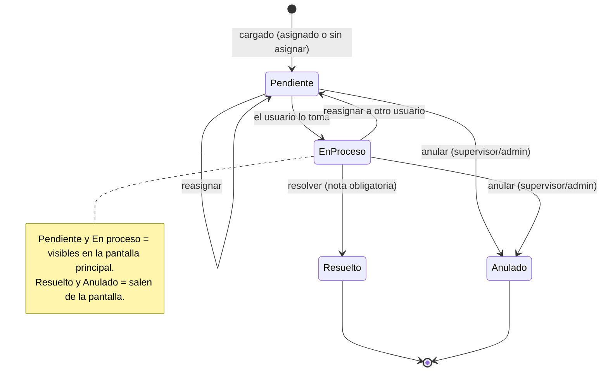

# Plan — TK Imperio: Tickets y Tareas del día

26/10/2026 · Alejandro Quevedo · Repo: [danqueve/tk_imperio](https://github.com/danqueve/tk_imperio) · Carpeta local: `C:\wamp64\www\tk`

> **Cómo usar este archivo en VS Code:** ejecutar una fase por vez (sección "Fases de desarrollo"), en orden. Al terminar cada fase: probar en WAMP64, hacer commit y marcar la casilla de esa fase.

---

## 1. Resumen y objetivos

TK Imperio es un sistema web (PHP + MySQL) para cargar problemáticas administrativas como tickets, asignarlas a una persona y seguirlas en una pantalla de pared que se actualiza sola cada 5 minutos.

Objetivos:

- Cualquier usuario carga tickets (DNI con búsqueda del cliente en SAS Imperio, problemática, hasta 3 imágenes) y tareas del día con compromiso; supervisores y administradores los asignan.
- Cada usuario ve sus tickets, los toma y los resuelve; al resolverse, el ticket sale de la pantalla principal.
- Una pantalla principal sin usuario frente a ella muestra una columna por usuario asignado, con los tickets apilados por orden de carga.
- Panel de administración para crear y gestionar usuarios.
- Funciona igual de bien en celular y en PC (diseño mobile-first).

---

## 2. Roles y permisos

Tres roles de usuario y un acceso especial para la pantalla de pared, que no usa usuario ni contraseña.

| Acción | Admin | Supervisor | Usuario | Pantalla |
| --- | --- | --- | --- | --- |
| Crear, editar y desactivar usuarios | Sí | No | No | No |
| Cargar tickets y tareas del día | Sí | Sí | Sí (para sí o sin asignar) | No |
| Asignar y reasignar | Sí | Sí | No | No |
| Ver todos los tickets | Sí | Sí | Solo los suyos | Solo abiertos |
| Tomar y resolver un ticket | Sí | Sí | Los suyos | No |
| Anular un ticket | Sí | Sí | No | No |
| Ver historial y reportes | Sí | Sí | Solo los suyos | No |
| Configurar pantalla (token, intervalo) | Sí | No | No | No |

- La pantalla entra con una URL que lleva un token secreto (por ejemplo `/pantalla/?t=...`). Así no depende de una sesión que vence, y el admin puede regenerar el token si se filtra.
- Desactivar un usuario no borra sus tickets: quedan en el historial y los abiertos se reasignan.
- **Los administradores son los mismos de SAS Imperio:** entran a TK con su usuario y contraseña de SAS; si dejan de ser admin allá, pierden el acceso acá.
- Supervisores y usuarios se crean en el panel de usuarios de TK.
- Lo que carga un usuario común queda asignado a él o sin asignar, y el supervisor lo reasigna.

---

## 3. Flujo del ticket y estados

Un ticket pasa por Pendiente y En proceso mientras está en la pantalla, y sale de ella al quedar Resuelto o Anulado.



- Tomar un ticket lo pasa a En proceso y registra quién y cuándo.
- Resolver exige una nota de solución, que queda en el historial.
- Reasignar devuelve el ticket a Pendiente con el nuevo usuario y lo mueve de columna en la pantalla.
- Las tareas del día siguen el mismo flujo.

Valores de `estado` en la base: `pendiente`, `en_proceso`, `resuelto`, `anulado`.

---

## 4. Pantalla principal (TV)

Una página de solo lectura con una columna por usuario asignado, los tickets abiertos apilados del más antiguo al más nuevo, que se actualiza sola cada 5 minutos sin que nadie la toque.

Boceto:

```
┌────────────────────────────────────────────────────────────────────────────────┐
│ TK Imperio · Tickets abiertos                 Actualizado hh:mm · próxima m:ss │
├────────────────────────────────────────────────────────────────────────────────┤
│ Sin asignar   1 │ Usuario A     2 │ Usuario B     2 │ Usuario C     1          │
│ ┌─────────────┐ │ ┌─────────────┐ │ ┌─────────────┐ │ ┌─────────────┐          │
│ │Apellido, Nom│ │ │Apellido, Nom│ │ │Apellido, Nom│ │ │Tarea del día│          │
│ │DNI · antig. │ │ │EN PROCESO   │ │ │PRIORID. ALTA│ │ │compromiso   │          │
│ └─────────────┘ │ └─────────────┘ │ └─────────────┘ │ └─────────────┘          │
│                 │ ┌─────────────┐ │ ┌─────────────┐ │                          │
│                 │ │Apellido, Nom│ │ │Apellido, Nom│ │                          │
│                 │ │DNI · antig. │ │ │DNI · antig. │ │                          │
│                 │ └─────────────┘ │ └─────────────┘ │                          │
└────────────────────────────────────────────────────────────────────────────────┘
  Azul: en proceso · Borde rojo: prioridad alta · Un ticket resuelto desaparece
  en la próxima actualización (máx. 5 min)
```

Cómo se mantiene al día sin intervención:

- La página carga una vez y cada 300 segundos pide los datos a `api/pantalla.php` (JSON). Solo redibuja si algo cambió, así la TV no parpadea.
- Si el servidor o internet fallan, mantiene lo último que mostró, avisa "Sin conexión" en la cabecera y reintenta cada 60 segundos.
- Una recarga completa por día (por ejemplo, a las 6:00) toma cambios de código y evita que el navegador acumule memoria.
- Usa la API Wake Lock y un botón de pantalla completa para que la TV no entre en reposo (requiere HTTPS).

Qué muestra cada tarjeta: nombre del cliente, DNI, antigüedad ("hace 2 h"), si está en proceso, si es prioridad alta, la fecha de compromiso (en rojo si ya venció) y un ícono si tiene imágenes. Un ticket nuevo se resalta unos segundos al aparecer.

- Solo aparecen las columnas de usuarios con algo asignado; "Sin asignar" va primera cuando tiene tickets.
- Si hay muchos tickets, cada columna muestra los que entran y al pie "+N más".
- Hasta 6 columnas entran cómodas en una TV Full HD; con más usuarios, las columnas se angostan y la letra baja un paso.
- Abierta en un celular, la misma vista se desliza columna por columna.

---

## 5. Módulos y pantallas

Ocho pantallas cubren todo el pedido; todas son responsive salvo la pantalla de pared, pensada para TV horizontal.

| Pantalla | Quién | Qué hace |
| --- | --- | --- |
| Login | Todos | Usuario y contraseña (los admin, con su cuenta de SAS Imperio); bloqueo temporal tras 5 intentos fallidos |
| Nuevo ticket | Todos | DNI (busca el cliente en SAS y completa el nombre), cliente, problemática, prioridad, asignado a (o sin asignar), hasta 3 imágenes (cámara o galería) |
| Nueva tarea del día | Todos | Título, descripción, asignado a, fecha; compromiso opcional (fecha y hora límite + detalle); sin DNI ni cliente |
| Bandeja | Todos | Supervisor: todos los abiertos con filtros por usuario y estado. Usuario: solo los suyos, el más antiguo arriba |
| Detalle del ticket | Todos | Datos, imágenes ampliables, historial, botones Tomar, Resolver (con nota obligatoria), Reasignar, Anular |
| Usuarios | Admin | Alta, edición, rol, activar/desactivar, reset de contraseña |
| Pantalla principal | TV | Columnas por usuario, autorefresco cada 5 min (ver sección 4) |
| Historial | Admin, supervisor | Tickets resueltos y anulados, búsqueda por DNI o cliente, exportar a CSV |

- En celular, la bandeja muestra tarjetas en una sola columna y la navegación va en una barra inferior.
- En PC, la bandeja es una tabla con filtros arriba.
- El formulario de imágenes reduce cada foto en el navegador (a unos 1600 px de lado) antes de subirla, porque las fotos de celular suelen pesar 4–8 MB.

---

## 6. Modelo de datos

Cinco tablas con prefijo `tk_` (MySQL 8, InnoDB, utf8mb4). Tickets y tareas del día comparten tabla con un campo `tipo`, así la pantalla y la bandeja los listan juntos.

| Tabla | Campos principales |
| --- | --- |
| `tk_usuarios` | id, nombre, usuario (único), password_hash (vacío si origen = sas), origen (local / sas), sas_usuario_id, rol (admin / supervisor / usuario), color, activo, ultimo_login, creado_en |
| `tk_tickets` | id, tipo (ticket / tarea), dni, cliente, sas_cliente_id (NULL si no está en SAS), titulo, problematica, prioridad (normal / alta), estado, asignado_a (NULL = sin asignar), creado_por, fecha_tarea, compromiso_fecha, compromiso_detalle, nota_resolucion, creado_en, tomado_en, resuelto_en, resuelto_por |
| `tk_ticket_imagenes` | id, ticket_id, archivo (nombre aleatorio), mime, tamano, orden (1–3), subido_en |
| `tk_ticket_eventos` | id, ticket_id, usuario_id, accion (creado / tomado / reasignado / resuelto / anulado / comentario), detalle, creado_en |
| `tk_config` | clave, valor (token de pantalla, intervalo de refresco, nombre de la empresa) |

Reglas en la base y en PHP:

- `dni` y `cliente` son obligatorios si `tipo = ticket`; `titulo` si `tipo = tarea`.
- Índice en (`estado`, `asignado_a`, `creado_en`): es la consulta que la pantalla hace cada 5 minutos.
- El límite de 3 imágenes se valida en PHP antes de guardar, contando las que ya tiene el ticket.
- Cada cambio de estado escribe un evento: ese es el historial de quién hizo qué y cuándo.

---

## 7. Stack, estructura de carpetas y seguridad

El mismo stack que SAS Imperio y el CRM, para desarrollar en WAMP64 y desplegar con `git pull` en el VPS de producción.

- **Backend:** PHP 8.x sin framework, PDO con consultas preparadas, una capa de servicios (`TicketService`, `UsuarioService`, `ImagenService`, `SasService`).
- **Frontend:** HTML + Bootstrap 5 + JavaScript sin dependencias pesadas; mobile-first.
- **Base:** MySQL 8, base propia (`tk_imperio`), separada de SAS y del CRM.
- **Dominio:** `tk.imperiocomercial.com.ar`. En el VPS de producción el proyecto tiene que vivir dentro de `public_html` y separarse por dominio con `RewriteCond %{HTTP_HOST}` en el `.htaccess`, como los otros subdominios.

### Conexión con SAS Imperio (solo lectura)

Mismo patrón que la agenda de cobranza. Base de SAS: `c2881399_credit`.

- Una segunda conexión PDO con un usuario MySQL propio que solo tiene `GRANT SELECT` sobre `ic_usuarios` e `ic_clientes`. TK nunca escribe en SAS.
- **Login de admins:** si el usuario no existe como local en TK, se busca en `ic_usuarios` por la columna `usuario`, con `rol = 'admin'` y `activo = 1`, y se valida con `password_verify` contra `password_hash`. Al entrar se crea o actualiza su fila en `tk_usuarios` con `origen = sas` y `sas_usuario_id`, para que sus tickets queden registrados.
- **Búsqueda por DNI:** al salir del campo DNI, `api/cliente.php?dni=` busca en `ic_clientes` por `dni` (comparando sin puntos ni espacios) y completa `apellidos` y `nombres`. En SAS el `dni` es `VARCHAR(20)`, no es único ni tiene índice: si aparece más de un cliente, se elige de una lista. Si no existe en SAS, se escribe a mano.
- En TK se guarda una copia del nombre en el ticket (`cliente`) y el `sas_cliente_id`, así el historial no cambia si el cliente se edita en SAS.
- SAS ya tiene su propio módulo de tickets (`ic_tickets`), usado para reclamos y posventa ligados a un crédito. TK no lo toca: es para problemáticas administrativas internas y tiene su propia base.

Columnas de SAS que usa TK:

| Tabla SAS | Columnas |
| --- | --- |
| `ic_usuarios` | `id`, `nombre`, `apellido`, `usuario`, `password_hash`, `rol` (enum admin/supervisor/cobrador/vendedor), `activo` |
| `ic_clientes` | `id`, `nombres`, `apellidos`, `dni`, `estado` |

Ejemplo de usuario de solo lectura (ajustar host y contraseña):

```sql
CREATE USER 'tk_sas_ro'@'localhost' IDENTIFIED BY '********';
GRANT SELECT ON c2881399_credit.ic_usuarios TO 'tk_sas_ro'@'localhost';
GRANT SELECT ON c2881399_credit.ic_clientes TO 'tk_sas_ro'@'localhost';
FLUSH PRIVILEGES;
```

### Estructura propuesta

```
tk/
├─ config/
│  ├─ config.php            (lee config.local.php)
│  └─ config.local.php      (credenciales TK + SAS solo lectura, NO va a git)
├─ src/                    (servicios, helpers, auth, csrf)
├─ public/
│  ├─ index.php             (login)
│  ├─ bandeja.php
│  ├─ ticket_nuevo.php
│  ├─ ticket.php            (detalle)
│  ├─ usuarios.php
│  ├─ historial.php
│  ├─ imagen.php            (sirve imágenes con control de acceso)
│  ├─ pantalla/index.php
│  ├─ api/pantalla.php      (JSON para el autorefresco)
│  ├─ api/cliente.php       (búsqueda por DNI en SAS)
│  └─ assets/ (css, js, img)
├─ uploads/                (imágenes; .htaccess Deny all, NO va a git)
├─ sql/schema.sql          (solo estructura, sin datos reales)
└─ .gitignore
```

### Seguridad

- Contraseñas con `password_hash`; sesión con `session_regenerate_id` al entrar y cookie `HttpOnly` + `Secure`.
- Token CSRF en todos los formularios y acciones (tomar, resolver, reasignar).
- Cada acción verifica rol y que el ticket pertenezca al usuario cuando corresponde.
- Imágenes: solo JPG, PNG y WEBP, tipo real verificado con `finfo`, máximo 5 MB, nombre aleatorio, y se sirven por `imagen.php` (nunca por URL directa).
- `.gitignore` desde el primer commit: `config/config.local.php`, `uploads/` y cualquier `*.sql` que no sea `sql/schema.sql`, para que no se repita el caso del dump con datos reales de sas_imperio.
- Backup: sumar la base `tk_imperio` y la carpeta `uploads/` al script diario de rclone que ya corre en el VPS.

---

## 8. Fases de desarrollo

Siete fases, cada una cerrada con un commit probado en WAMP64; la pantalla de pared llega en la fase 5 porque necesita tickets reales para probarse.

- [x] **Fase 1 — Base del proyecto.** Repo clonado en `C:\wamp64\www\tk`, `.gitignore`, `config.local.php` (con las dos conexiones: TK y SAS solo lectura), `sql/schema.sql`, layout responsive (barra superior en PC, barra inferior en celular).
- [x] **Fase 2 — Login y usuarios.** Auth por sesión, login de admins con su cuenta de SAS Imperio (conexión de solo lectura), CSRF, roles, panel de usuarios para el admin, usuario admin inicial por script.
- [x] **Fase 3 — Tickets y tareas.** Formulario de carga con búsqueda del cliente por DNI en SAS, compromiso para las tareas, opción sin asignar y hasta 3 imágenes (reducidas en el navegador), detalle, bandeja del supervisor y bandeja del usuario.
- [ ] **Fase 4 — Flujo de estados.** Tomar, resolver con nota obligatoria, reasignar, anular; cada acción escribe en `tk_ticket_eventos`.
- [ ] **Fase 5 — Pantalla principal.** Endpoint JSON, vista de TV por columnas, autorefresco cada 5 min, token de acceso.
- [ ] **Fase 6 — Historial y reportes.** Búsqueda por DNI o cliente, filtros por fecha y usuario, exportar CSV, tiempo promedio de resolución por usuario.
- [ ] **Fase 7 — Deploy.** Subdominio en el VPS, regla en `.htaccess`, base en producción, usuario MySQL de solo lectura sobre SAS, backup en rclone, prueba en la TV real y en celulares.

---

## 9. Decisiones tomadas

Confirmadas el 26/10/2026 y ya aplicadas en las secciones de arriba.

| Tema | Decisión |
| --- | --- |
| Tareas del día | Tareas sin cliente, en la misma tabla (`tipo = tarea`), con un compromiso opcional: fecha y hora límite + detalle |
| Columnas en la pantalla | Un usuario sin nada asignado no aparece |
| Quién carga | Todos los usuarios pueden cargar tickets y tareas |
| Sin asignar | Se puede cargar sin asignar; aparece en la columna "Sin asignar" |
| DNI desde SAS Imperio | Entra en el alcance: el DNI completa el nombre del cliente consultando SAS en solo lectura (fase 3) |
| Avisos | No hacen falta: la asignación se ve en la pantalla |
| Subdominio | `tk.imperiocomercial.com.ar` |
| Administradores | Son los admin de SAS Imperio y entran con su misma cuenta |
